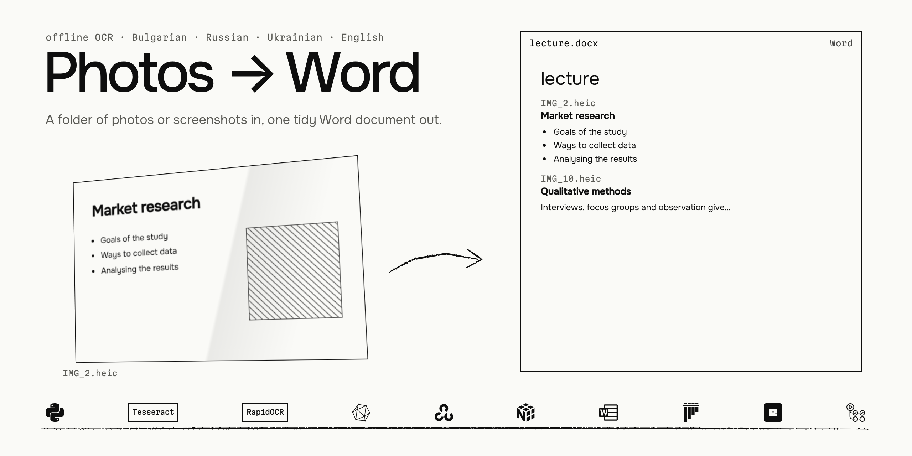
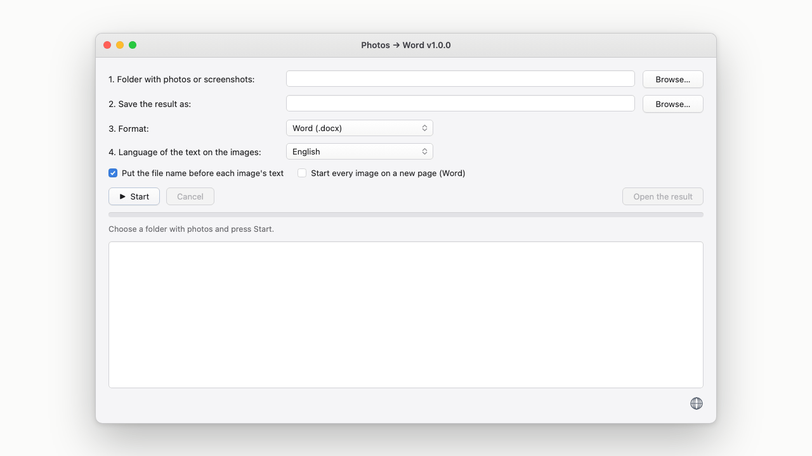
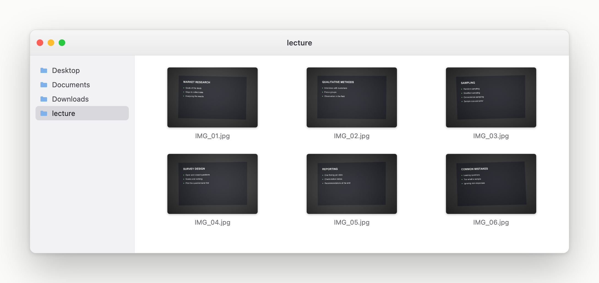
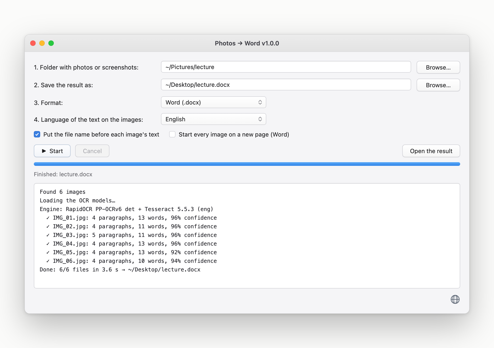
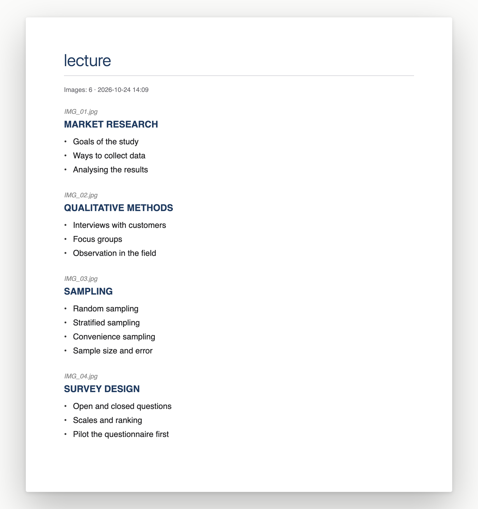

[](https://github.com/vinter-man/ss-to-word/actions/workflows/ci.yml)


[](LICENSE)



## Short description

You sit in a lecture and photograph the slides off the projector. Forty shots later you have a
folder nobody will ever read: tilted, glary, half picture and half text, and impossible to
search.

This turns that folder into one Word file. Pick the folder, pick where to save it, press Start.
The photos are read in the order their names put them, and their text lands in the document as
headings, bullet lists and paragraphs — or as plain text, if that is what you want.

It reads **Bulgarian, Russian, Ukrainian and English**, including HEIC straight off an iPhone.
Everything happens on your own machine: the models ship with the program, nothing is uploaded
and no API key exists to forget.



---

## Table of contents

* [User guide](#user-guide)
  * [Put the photos in one folder](#folder)
  * [Press Start](#start)
  * [Read the result](#result)
  * [Speak your own language](#language)
* [Installation](#installation)
  * [macOS](#macos)
  * [Windows](#windows)
  * [Any OS, by hand](#manual)
* [Options](#options)
* [How good is it](#accuracy)
* [Under the hood](#hood)
* [Limitations](#limitations)
* [Contact](#contact)

---
---

## <a name="user-guide"></a> User guide

### <a name="folder"></a> Put the photos in one folder

Whatever your phone dropped there is fine: PNG, JPEG, HEIC, WebP, BMP, TIFF, GIF. Names do not
matter, order does — the files are processed alphabetically, with numbers compared as numbers,
so `IMG_2` comes before `IMG_10` instead of after it.



Subfolders are left alone. Only what sits directly in the folder is read.

### <a name="start"></a> Press Start

Four fields and two checkboxes. The language in step 4 is the language *on the photos*, not the
language of the window.



The log is the honest part. It names the engine it actually got, and for every file how many
paragraphs and words came out and how sure the recognizer was. A photo that read badly, or
produced no text at all, is called out by name, so you know which three of the forty are worth
reshooting instead of discovering it a week later.

> :suspect: Under the hood two OCR engines split the job along their strengths. Lines are found
> by [RapidOCR](https://github.com/RapidAI/RapidOCR)'s PP-OCR detector, which copes with tilt,
> glare and a photograph sitting next to the text. Each line is then cut from the full-resolution
> image, straightened, inverted if it is light text on a dark background, and read by Tesseract
> with its own language model.
>
> Neither one alone was good enough. Tesseract's page segmentation is what breaks on a
> photographed slide — it returns empty pages or reads two columns as one — while RapidOCR's
> recognizer is accurate but drops words. Detecting with one and reading with the other took word
> recall from 80 % to 99.6 % on the development corpus, and the scripts that measured it are in
> [`bench/`](bench). [How good is it](#accuracy) has the table.

### <a name="result"></a> Read the result



Headings stay headings, bullets stay bullets, and a word broken across two lines is put back
together. The file name goes above each slide's text so you can find the original photo. The
document's proofing language is set to the language you picked, so Word does not greet you with
a sea of red underlines.

### <a name="language"></a> Speak your own language

The globe in the bottom-right corner of the window switches the interface between English,
Bulgarian, Ukrainian and Russian. English is the default and your choice is remembered.

The log, the command line and the code stay English on purpose: those are read by whoever fixes
the program, not by whoever uses it.

---
---

## <a name="installation"></a> Installation

### <a name="macos"></a> macOS

1. Install Python 3.11+ from [python.org](https://www.python.org/downloads/macos/). The system
   `/usr/bin/python3` is too old and carries Tk 8.5, which the window looks dated on.
2. `brew install tesseract`. Only the binary is needed; the language models are bundled here, so
   `tesseract-lang` is not.
3. Double-click `start_mac.command`. The first run builds a virtualenv and installs the
   dependencies, one to three minutes.

> 3.11, 3.12 and 3.13 work everywhere the program does, including Intel Macs and macOS 13. The
> OCR wheels for 3.14 exist only for Apple Silicon on macOS 14+, which is why the launcher tries
> it last.
>
> If the file will not run: `chmod +x start_mac.command`. If macOS says the developer cannot be
> verified, right-click → Open → Open, or `xattr -d com.apple.quarantine start_mac.command`.

### <a name="windows"></a> Windows

1. Install Python 3.11+ from [python.org](https://www.python.org/downloads/windows/) and tick
   **Add python.exe to PATH**.
2. Install Tesseract from [UB-Mannheim](https://github.com/UB-Mannheim/tesseract/wiki). The
   default location is fine and no extra languages are needed.
3. Double-click `start_windows.bat`. If SmartScreen appears: More info → Run anyway.

> Everything the launcher does is written to `setup-log.txt`, and the window stays open on an
> error instead of flashing shut. `diagnose.bat` collects Python, Tk, Tesseract and package state
> into `diagnose-log.txt` next to it — that file plus `setup-log.txt` is what to ask for when
> something goes wrong on a machine you cannot see.

Tesseract is optional on both systems. Without it the program falls back to RapidOCR's own
recognizer and says so in the log. It reads noticeably worse: on the three sample photos,
8 paragraphs out of 12 instead of 12, at a 0.63 % character error rate instead of 0.00 %
(`bench/structure.py --rapid`).

### <a name="manual"></a> Any OS, by hand

```bash
python3 -m venv .venv
.venv/bin/pip install -r requirements.txt
.venv/bin/python main.py
```

On Windows that is `.venv\Scripts\pip` and `.venv\Scripts\python`. The window needs Tk, which on
Linux means the distribution's `python3-tk`; the `-i`/`-o` form runs without it.

---

## <a name="options"></a> Options

`main.py` with no arguments opens the window. With `-i` and `-o` it runs headless, which is what
you want from a script or a cron job.

```
main.py [-i FOLDER -o FILE] [-f docx|txt] [--lang LANG] [--no-file-headings]
        [--page-breaks] [--no-tesseract] [--gui] [-v]
```

| Option | Default | What it does |
| --- | --- | --- |
| `-i, --input` | — | folder with the images, not recursive |
| `-o, --output` | — | the file to write |
| `-f, --format` | `txt` for a `.txt` output, else `docx` | `docx` or `txt` |
| `--lang` | `bul` | language **on the images** |
| `--no-file-headings` | off | do not print the file name above each image's text |
| `--page-breaks` | off | start every image on a new page (Word only) |
| `--no-tesseract` | off | force the built-in fallback recognizer |
| `--gui` | — | open the window even with `-i`/`-o` given |
| `-v, --verbose` | off | debug-level log |

`--lang` takes `bul`, `rus`, `ukr`, `eng` and the names a person would actually type, in English
or in the language itself. Several at once work — `--lang bul+eng` for slides with English terms
in them — at the cost of speed.

```bash
.venv/bin/python main.py -i ~/Pictures/lecture -o ~/Desktop/lecture.docx
.venv/bin/python main.py -i ~/Pictures/notes -o ~/Desktop/notes.txt --lang ukr --no-file-headings
.venv/bin/python main.py -i ~/Pictures/slides -o ~/Desktop/slides.docx --lang bul+eng --page-breaks
```

The folder, the output path, the format, both languages and the two checkboxes are remembered in
`~/.ss_to_word.json`.

---

## <a name="accuracy"></a> How good is it

Three photos of real slides ship with the repository, next to a hand-made transcription in
`bench/ground_truth.json`, so you can measure it yourself rather than take my word for it:

```bash
.venv/bin/pip install -r requirements-dev.txt
.venv/bin/python -m pytest -q                  # unit, GUI and end-to-end tests
.venv/bin/python bench/structure.py --show     # accuracy of the finished document
.venv/bin/python bench/benchmark.py app app_no_tesseract tess_psm3_x2 rapidocr
```

All four read the three photos in `images/` and nothing else, so what they print is the
three-photo figure, not the table further down.

On those three photos the finished document matches the transcription **12 paragraphs out of
12**, word for word and with the right kind of block, at a **0.00 % character error rate**.

The engine comparison that shaped the design was made earlier on the full development corpus of
19 photos from the same lecture. Those numbers are a record, not a claim you can re-run here —
sixteen of the photos are somebody else's lecture and stayed private:

| Engine | Word recall | Word precision | Time |
|---|---|---|---|
| Tesseract on the whole photo | 78.8 % | 78.2 % | 0.3 s/photo |
| EasyOCR | 78.1 % | 76.8 % | 2.6 s/photo |
| RapidOCR (PP-OCRv5 cyrillic) | 80.7 % | 94.9 % | 0.2 s/photo |
| **RapidOCR detection + Tesseract per line** (chosen) | **99.6 %** | **96.0 %** | 0.2 s/photo |
| RapidOCR detection + RapidOCR recognition (fallback) | 95.6 % | 94.1 % | 0.2 s/photo |

Over those 19 photos the finished document came out at a 0.38 % character error rate with 93 %
of paragraphs matching exactly; every mismatch was on the three flow-chart slides, and on the 16
ordinary ones the match was 100 %. [DESIGN_NOTES.md](DESIGN_NOTES.md) is where all of it was
written down.

---

## <a name="hood"></a> Under the hood

```
photos ─→ detect ─→ recognize ─→ orient ─→ layout ─→ export
          RapidOCR  Tesseract    3 signals  geometry  python-docx
```

Everything below lives in `ss_to_word/`:

| File | What is in it |
|---|---|
| `ocr/engine.py` | detection, per-line recognition, and the decision to turn a page |
| `ocr/tesseract.py` | finding the binary, bundled tessdata, one process per line over stdin |
| `images.py` | finding and opening the images, EXIF orientation, HEIC |
| `layout.py` | lines → headings, bullets, paragraphs. No OCR anywhere in it |
| `pipeline.py` | the job: walk the folder, call the engine, report progress, write the file |
| `export.py` | the Word and plain-text writers |
| `gui.py`, `i18n.py` | the window and the four interface languages |
| `languages.py` | the languages the OCR can read; adding one is a tuple and a model file |

```bash
.venv/bin/python -m pytest        # 198 tests
.venv/bin/ruff check .
```

CI runs the suite on macOS and Windows against Python 3.11 and 3.13.

> :shipit: [DESIGN_NOTES.md](DESIGN_NOTES.md) is what was measured and why the constants are what
> they are — including the two rotation fixes that were tried, failed, and are written down so
> nobody tries them again, and an honest list of the places that were tuned by eye rather than
> measured.

---

## <a name="limitations"></a> Limitations

* Flow charts are read, but the order of their boxes is a best effort. The text is all there.
* Handwriting and text inside a photograph on a slide are usually dropped as noise — but a
  caption printed inside a photo can read cleanly enough to end up in the document, and it
  arrives with high confidence, so the log will not flag it. Skim for lines that do not belong.
* Resolution is the one thing worth caring about when you shoot. Halving a photo costs almost
  nothing; at a quarter — around 10 px per line — nothing usable comes out in any orientation.
  Stand closer rather than zooming. Tilt is handled: the lines are deskewed before they are
  grouped.
* A page whose text says nothing about which way is up — a table of numbers, a column of single
  letters, letters that look identical after a 180° turn — is never rotated, because the two
  orientations are indistinguishable in the pixels. Photographed upside down, a table of numbers
  is not recovered, and that costs the **values**, not just the row order. Rotate those before
  running.
* Every line is a separate `tesseract` process. A real-time antivirus that inspects every process
  launch — the normal state of a Windows machine — makes itself felt on a folder of forty photos.
* Windows with a non-ASCII user name: the program finds a workable path to the models itself. If
  the log still says RapidOCR, copy `ss_to_word\models\tessdata\*.traineddata` somewhere
  ASCII-only and set `TESSDATA_PREFIX` to it. `TESSERACT_CMD` points at `tesseract.exe` if it
  lives somewhere unusual.

---

## <a name="contact"></a> Contact

GitHub: [vinter-man](https://github.com/vinter-man)

License: [MIT](LICENSE), take it and read
